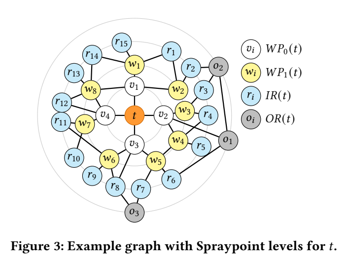

# 1. Spraypoint Protocol
Spraypoint is a fully distributed, demand-oblivious link-state routing protocol designed for flat datacenter expander networks (such as Amazon's RNG fabric). Traditional shortest-path routing performs poorly on expander topologies because it cannot exploit the wide diversity of paths available. Spraypoint addresses this by finding a large number of edge-disjoint paths (close to the node degree $d$) between any pair of endpoints, enabling Equal-Cost Multi-Path (ECMP) routing to maximize network throughput and capacity fungibility.

---

## 1. Protocol Parameters

Spraypoint relies on two primary configuration parameters and one calculated auxiliary parameter:

- **$p$ (Waypoints per Node):** Specifies the number of waypoint neighbors randomly selected per node at lower levels.
- **$h$ (Eligible Next Hops):** Specifies the number of eligible next hops randomly selected for forwarding during pointing steps.
- **$l$ (Number of Waypoint Levels):** An auxiliary parameter calculated based on network size ($n$), node degree ($d$), and waypoint fan-out ($p$) as:
  $$l = \max\left(1, \left\lceil \log_p \left( \frac{n}{2d^2} \right) \right\rceil\right)$$
  For typical datacenter deployments ($n=10\text{K}$, $d=64$), setting $l=1$ is sufficient.

---

## 2. Destination-Specific Level Partitioning

For every destination node $t$ in the network, Spraypoint partitions all routers into four distinct levels to build a directed pointing graph toward $t$:

1. **$\text{WP}_0(t)$ (Base Waypoint Level):** Consists of all direct neighbors of destination $t$ (i.e., $\text{Nbr}(t)$).
2. **$\text{WP}_m(t)$ (Higher Waypoint Levels for $m \in [1, l]$):** Each node in $\text{WP}_{m-1}(t)$ randomly selects $p$ of its neighbors. Nodes in earlier waypoint levels and destination $t$ itself are excluded.
3. **$\text{IR}(t)$ (Inner Ring):** Contains all neighbors of nodes in $\text{WP}_l(t)$ that are not part of any prior waypoint level.
4. **$\text{OR}(t)$ (Outer Ring):** Contains all remaining nodes in the network that do not belong to any of the levels above.

---

## 3. Two-Stage Forwarding Mechanism

### Stage 1: Spraying at the Source ($s$)
- When a packet originates at source router $s$ destined for $t$, $s$ sprays the packet by picking a neighbor uniformly at random across all its fabric interfaces using ECMP hashing.
- Spraying occurs only at the source and takes place regardless of the destination—even if source $s$ and destination $t$ are direct physical neighbors.
- **Purpose:** High fan-out at the source distributes traffic across independent paths, leveraging the expansion property of random graphs.

### Stage 2: Pointing at Intermediate Nodes ($u$)
Once sprayed, any intermediate router $u$ inspects its assigned level relative to destination $t$ and applies the pointing rules:
- **If $u \in \text{WP}_0(t)$:** Forward directly to destination $t$.
- **If $u \in \text{WP}_m(t)$ ($m \in [1, l]$):** Forward via ECMP to one of $h$ neighbors randomly selected from $\text{WP}_{m-1}(t)$.
- **If $u \in \text{IR}(t)$:** Forward via ECMP to one of $h$ neighbors randomly selected from $\text{WP}_l(t)$.
- **If $u \in \text{OR}(t)$:** Forward via ECMP to one of $h$ neighbors randomly selected from those having shortest paths to $\text{IR}(t)$ nodes.

> **Why Waypoints?** Waypoints construct a $p$-ary forwarding tree directed at $t$. Without higher-level waypoints, packets sprayed from a neighbor of $t$ would immediately route back through source $s$, collapsing throughput on the direct $s \to t$ link.

---

## 4. Implementation & Hardware Architecture

### Loop Prevention & Distributed Control Plane
- **Link-State Topology View:** Spraypoint operates as a link-state protocol where every node has full topology visibility and independently calculates level assignments and next hops.
- **Deterministic Waypoint Hashing:** To guarantee that pointing graphs remain completely loop-free across all routers, all nodes make identical waypoint selections by applying deterministic hashing with a shared key.

### 2-VRF Switch Configuration
To prevent infinite looping when packets revisit intermediate routers, commodity switches use two Virtual Routing and Forwarding (VRF) instances:
1. **Server-Facing VRF:** Bound to all server-facing interfaces. Incoming traffic from connected servers is sprayed to all fabric-facing interfaces (except local intra-switch traffic).
2. **Fabric-Facing VRF:** Bound to all fabric-facing interfaces. Incoming transit traffic follows the deterministic pointing rules.

*This dual-VRF isolation ensures a packet can revisit its source node at most once during the spraying phase without looping.*

---

## 5. Memory & Hardware Complexity

Spraypoint is designed to run within commodity switch ASIC constraints:

- **Longest-Prefix Match (LPM) Memory:** Maps destination IP addresses to ECMP group IDs (identical memory footprint to fat-tree networks).
- **ECMP Group Memory:** By pre-defining all $d^h$ possible next-hop combinations, a 128-port switch ($d \approx 64$) configured with $h=2$ requires only $\approx 8\text{K}$ ECMP entries ($hd^h$), fitting easily in standard memory.
- **CPU Complexity:** Computing levels and pointing sets requires $O(n^2 d)$ time per node per recalculation, which modern switch control-plane CPUs process easily.
---
# Example
Taking the example in the image:

## Step 1: Destination-Specific Level Partitioning for $t$

Every node in the network computes its relative level with respect to destination $t$:

1. **$WP_0(t)$ (Base Waypoints):** Direct neighbors of destination $t$, consisting of $\{v_1, v_2, v_3, v_4\}$.

2. **$WP_1(t)$ (Level 1 Waypoints):** Each node in $WP_0(t)$ randomly selects $p=2$ neighbors (excluding $t$ and other base waypoints). For example, $v_1$ selects $\{w_1, w_2\}$, $v_2$ selects $\{w_3, w_4\}$, and $v_4$ selects $\{w_8\}$. Node $v_1$ ends up with three incoming waypoint links because $w_8$ was also selected by $v_4$.

3. **$IR(t)$ (Inner Ring):** Remaining neighbors of $WP_1(t)$ that are not in prior levels (e.g., $r_1, r_2, \dots$).

4. **$OR(t)$ (Outer Ring):** All other remaining switches in the network (e.g., $o_1, o_2, \dots$).

Summary of the roles on nodes:
| Level / Layer | Nodes Included | Description |
| :--- | :--- | :--- |
| **Target ($t$)** | `t` | Destination router |
| **$WP_0(t)$** | `v1`, `v2`, `v3`, `v4` | Base waypoints (direct neighbors of $t$) |
| **$WP_1(t)$** | `w1`, `w2`, `w3`, `w4`, `w5`, `w6`, `w7`, `w8` | Higher-level waypoints assigned from $WP_0$ |
| **$IR(t)$** | `r1`, `r2`, `r3`, `r4`, `r5`, `r6`, `r7`, `r8`, `r9`, `r10`, `r11`, `r12`, `r13`, `r14`, `r15` | Inner Ring nodes |
| **$OR(t)$** | `o1`, `o2`, `o3` | Outer Ring nodes |

---

## Step 2: Packet Forwarding Walkthrough (Source $v_2 \rightarrow$ Destination $t$)

When source node $v_2$ transmits a packet to destination $t$:

* **Spraying Step at $v_2$:** Source $v_2$ ignores its direct connection to $t$ and sprays the packet across all its fabric links uniformly at random using ECMP. Its neighbors are $t$, $w_3$, $w_4$, and $o_1$.

* If sprayed directly to $t$, the packet arrives immediately.

* If sprayed to $w_3$ or $w_4$ (which belong to $WP_1(t)$), $w_3$ inspects its pointing rules and uses ECMP to select $h=1$ parent in $WP_0(t)$—forwarding the packet back to $v_2$, which then forwards it directly to $t$.

* If sprayed to $o_1$ (which belongs to $OR(t)$), $o_1$ forwards along a shortest path to an Inner Ring node ($r_6$), which forwards to $WP_1(t)$ ($w_5$), then to $WP_0(t)$ ($v_3$), and finally to $t$.